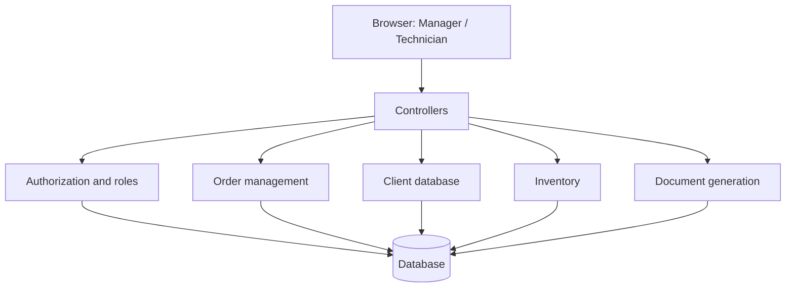
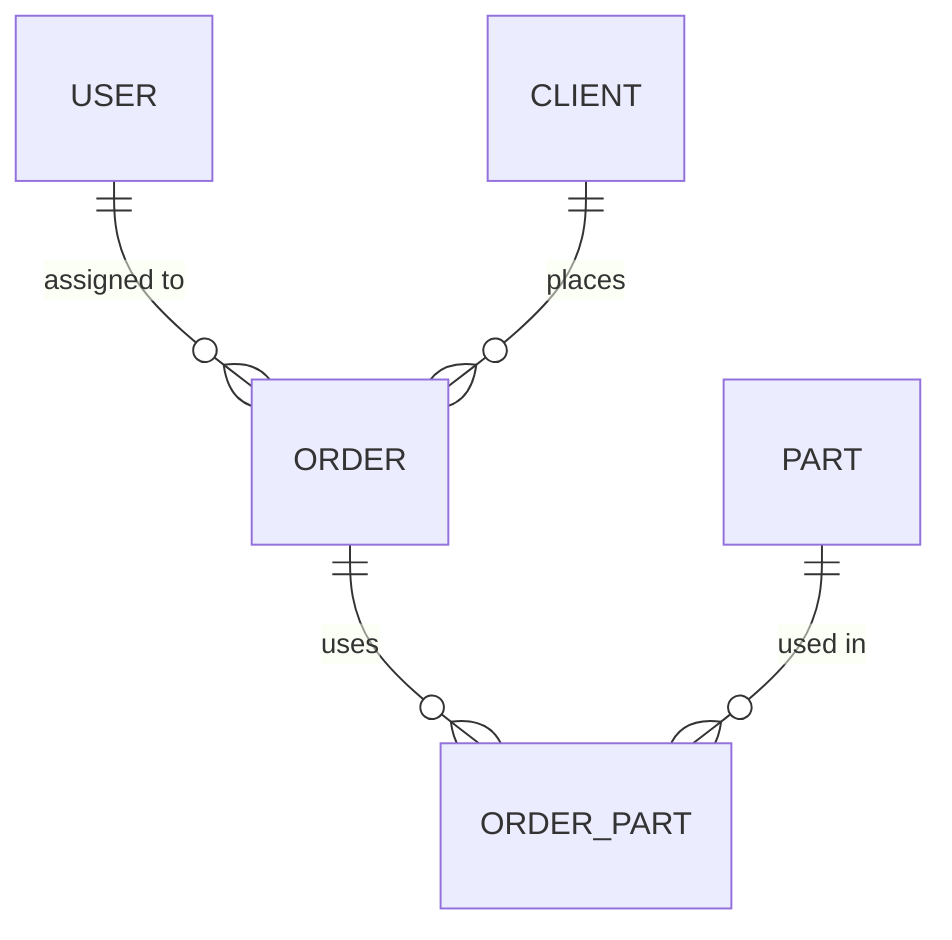

# 03. Architecture Description

Structured after ISO/IEC/IEEE 42010:2022: stakeholders, concerns, viewpoints and views.

## 1. Stakeholders and concerns

| Stakeholder | Concerns |
|---|---|
| Workshop owner | Cost, reliability, protection of stock |
| Manager | Speed of order intake, correct documents |
| Technician | Simple status and parts logging |
| Developer | Modularity, maintainability |

## 2. Architectural decisions

- **Style:** client-server web application, accessed from any device via browser.
- **Pattern:** Model-View-Controller, to separate data, logic and presentation.
- **Back-end:** .NET, C#.
- **Front-end:** HTML, CSS, JavaScript.
- **Database:** relational (SQL Server or SQLite).

## 3. Logical view (modules)

| Module | Responsibility |
|---|---|
| Authorization and roles | Login, session, role checks |
| Order management | Orders, statuses, comments, assignment |
| Client database | Client records, search, history |
| Inventory | Parts list, stock, deduction |
| Document generation | Receipt and certificate of completion as printable HTML |

## 4. Data view

Main entities: USER (username, password hash, role), CLIENT (name, phone), ORDER (device, problem, status, dates, total), PART (code, name, quantity, price), ORDER_PART (quantity, price at repair).

## 5. Deployment view

One server runs the .NET application and the database. Users connect through a browser over HTTPS.
