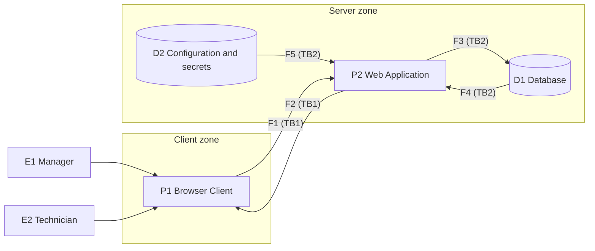

# Threat Model - Service Manager

Name: Security Policy - `Service Manager`
Version: 1.0.0
Status: Active
Classification: Internal
Last updated: 2026-11-05
Owner: Roman Zaitsev
Related documents: [06-security.md](06-security.md), [07-security-policy.md](07-security-policy.md), [09-threat-model.md](09-threat-model.md)

## Scope

The model covers the runtime part of the system: client-side code delivered to the browser, the server-side .NET MVC application (authorization, orders, clients, inventory, document generation), the database, and the configuration/secrets storage. One model is used for the whole project because it is a single small application.

Out of scope: the server operating system and physical security, the user's own device and browser, internals of third-party libraries, and the development process (repository, branches, dependencies), which is covered by [07-security-policy.md](07-security-policy.md).

## System Overview

Service Manager is a web application for a repair workshop. A Manager registers clients and orders and prints documents. A Technician sees only assigned orders, changes statuses and logs used parts. Users connect through a browser over HTTPS to a server that runs the application and the database.

**DFD (Data Flow Diagram)** shows how data moves through the system, where it is processed and stored, and who interacts with it. It is the basis of the STRIDE analysis below.

| ID | DFD Type | Name |
| --- | --- | --- |
| E1 | External Interactor | Manager |
| E2 | External Interactor | Technician |
| P1 | Process | Browser Client (HTML/CSS/JS) |
| P2 | Process | Web Application (MVC controllers, authorization, order/client/inventory logic, documents) |
| D1 | Data Store | Database (users, clients, orders, parts, audit log) |
| D2 | Data Store | Configuration and secrets (user-secrets / environment variables) |
| F1 | Data Flow | Browser Client -> Web Application |
| F2 | Data Flow | Web Application -> Browser Client |
| F3 | Data Flow | Web Application -> Database |
| F4 | Data Flow | Database -> Web Application |
| F5 | Data Flow | Configuration and secrets -> Web Application |
| TB1 | Trust Boundary | Browser Client / Web Application |
| TB2 | Trust Boundary | Web Application / Database and configuration |

**Relations:**

- `E1` and `E2` interact with `P1`.
- `P1` and `P2` exchange data through `F1` and `F2`, which cross `TB1`.
- `P2` writes to and reads from `D1` through `F3` and `F4`, which cross `TB2`.
- `P2` reads `D2` through `F5`, which crosses `TB2`.

## Intruder Model

| ID | Intruder | Initial access | Capabilities |
| --- | --- | --- | --- |
| A1 | Unauthenticated external user | Login page and public endpoints | Password guessing, injection, request flooding, traffic interception |
| A2 | Technician (dishonest or with a stolen account) | Own session and assigned orders | Changing IDs, quantities and prices in requests; trying to reach foreign orders or Manager functions |
| A3 | Manager (dishonest or with a stolen account) | All orders, clients, prices | Abusing client data, manipulating stock and statuses, denying actions |
| A4 | Person with server or database access | Server file system, database file, configuration | Reading or changing the database and secrets |
| A5 | Compromised dependency | Code inside the application | Reading data and secrets, modifying data |

## STRIDE Analysis

Applicable categories: External Interactor - S, R; Data Flow and Data Store - T, I, D; Process - S, T, R, I, D, E. Cells without a relevant scenario contain `-`. SEC-* identifiers refer to [06-security.md](06-security.md).

**E1 Manager** Intruder logs in as a Manager with a weak or stolen password SEC-1, SEC. Manager denies changing a status or releasing a device SEC-6.
**E2 Technician** Intruder logs in as a Technician with a weak or stolen password SEC-1, SEC-8. Technician denies writing off a part SEC-6.
**P1 Browser Client** Injected script (XSS) steals the session cookie SEC-13, SEC-14. Client-side validation or the request is modified before sending SEC-3. Buttons hidden for a role are reached by a direct request SEC-2, SEC-9.
**P2 Web Application** Forged cross-site request CSRF or stolen session is used SEC-4, SEC-13. Quantity, price, status or order ID in a request is altered: negative stock, changed price, skipped statuses SEC-10, SEC-15. Changes cannot be tied to a user because the audit log is incomplete SEC-6. Stored XSS via comments or client name; verbose errors; Technician receives foreign order data SEC-7, SEC-9, SEC-14. Mass login or search requests exhaust resources SEC-8. Technician changes the order ID in the URL (IDOR) or calls a Manager action without a role check SEC-2, SEC-9.
**D1 Database** SQL injection or direct file access changes or deletes data SEC-3, SEC-10, SEC-16. SQL injection or a leaked database file or backup exposes client data and password hashes SEC-1, SEC-3, SEC-16. Database is locked, overloaded or deleted SEC-8, SEC-17.
**D2 Configuration and secrets** Connection string is changed, redirecting the application to another database SEC-11. Secret is committed to Git, logged, or stored in `appsettings.json` SEC-11, SEC-12.
**F1 Browser Client -> Web Application** Request is modified in transit SEC-5. Credentials and client data are intercepted without HTTPS SEC-5. Flow is flooded with requests SEC-8.
**F2 Web Application -> Browser Client** Page or document is modified in transit SEC-5. Pages and cookies are intercepted or cached SEC-5, SEC-13.
**F3 Web Application -> Database** Query is altered or injected SEC-3. Query data is exposed if the database is on another host without protection SEC-11. Excessive queries block the database SEC-8.
**F4 Database -> Web Application** Results are modified before reaching the application.Results with client data are intercepted.
**F5 Configuration and secrets -> Web Application**  Values are replaced before startup (SEC-11). | - | Secrets leak through environment dumps or logs (SEC-12). | - | - |

## Threat Coverage by Intruder

| Intruder | Main protections |
| --- | --- |
| A1 | SEC-1, SEC-3, SEC-5, SEC-8, SEC-14 |
| A2 | SEC-2, SEC-9, SEC-10 |
| A3 | SEC-6, [08-privacy-policy.md](08-privacy-policy.md) |
| A4 | SEC-11, SEC-16, SEC-17 |
| A5 | Dependency checks in [07-security-policy.md](07-security-policy.md)